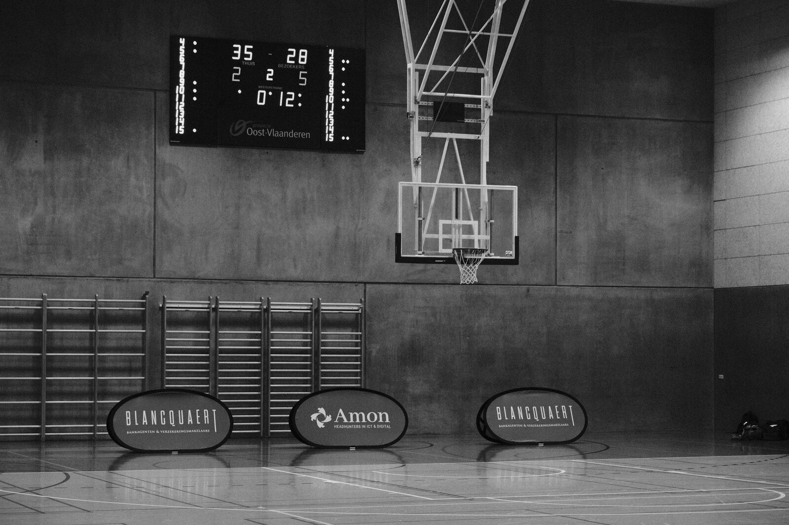

```{=html}
<main>

<!-- ===== PAGE HEAD ===== -->
<section class="page-head">
  <div class="page-head-inner">
    <p class="kicker">About me</p>
    <h1 class="d-title">Psychologist and athlete</h1>
    <p class="lede">
      I help people perform at the moments that matter to them.
      Not by pushing harder, but by dealing more wisely with pressure,
      mindset and recovery.
    </p>
  </div>
</section>

<!-- ===== INTRO ===== -->
<section class="section">
  <div class="section-inner meet">
    <figure class="photo-frame rv" style="margin:0">
      
      <figcaption class="photo-caption">
        <span>Emma Boone, Ghent</span>
      </figcaption>
    </figure>
    <div class="meet-text rv rv-1">
      <p>
        I'm Emma Boone, a clinical psychologist specialised in sport and
        performance psychology. <b>Sport and psychology</b> have been my two
        passions from a young age.
      </p>
      <p>
        As a clinical psychologist, I was fascinated time and again by people's
        drive and resilience. As a student psychologist, I discovered themes such as
        concentration, motivation and stress management. Together with my passion
        for sport, this led me to sport psychology and an additional postgraduate programme.
      </p>
      <p>
        I regularly line up at the start as a runner, or head into the mountains.
        So I know competition nerves and doubt at kilometre 30 from more than just
        the textbooks. Being ambitious while staying yourself is a search for me
        too, and I'm glad to help you with it.
      </p>
      <ul class="meet-facts">
        <li>Behaviour therapy</li>
        <li>Systemic therapy</li>
        <li>EMDR</li>
        <li>ACT</li>
        <li>Heart coherence</li>
        <li>NL / EN</li>
      </ul>
    </div>
  </div>
</section>

<!-- ===== BACKGROUND ===== -->
<section class="section" style="background: var(--paper-deep); border-block: 1px solid var(--line);">
  <div class="section-head rv">
    <p class="kicker">Background</p>
    <h2 class="d-title">Education &amp; experience</h2>
  </div>
  <div class="section-inner cv">
    <div class="cv-col rv">
      <h3>Education</h3>
      <p class="cv-order">Most recent first ↓</p>
      <ul class="cv-list">
        <li>
          <span class="cv-year">2025</span>
          <div>
            <span class="cv-date">June 2025</span>
            <strong>ACT basic training</strong>
            <p>ACT academie</p>
          </div>
        </li>
        <li>
          <span class="cv-year">2024</span>
          <div>
            <span class="cv-date">September 2024 – June 2026</span>
            <strong>Practice-oriented sport psychology</strong>
            <p>KU Leuven</p>
          </div>
        </li>
        <li>
          <span class="cv-year"></span>
          <div>
            <span class="cv-date">May 2024</span>
            <strong>EMDR Part 2</strong>
            <p>Integrativa</p>
          </div>
        </li>
        <li>
          <span class="cv-year">2023</span>
          <div>
            <span class="cv-date">December 2023</span>
            <strong>Sport Talent Passport</strong>
            <p>August360</p>
          </div>
        </li>
        <li>
          <span class="cv-year"></span>
          <div>
            <span class="cv-date">October 2023</span>
            <strong>EMDR Part 1</strong>
            <p>Integrativa</p>
          </div>
        </li>
        <li>
          <span class="cv-year"></span>
          <div>
            <span class="cv-date">May – June 2023</span>
            <strong>Basic training in eating disorders</strong>
            <p>Eetexpert</p>
          </div>
        </li>
        <li>
          <span class="cv-year"></span>
          <div>
            <span class="cv-date">May 2023 – June 2023</span>
            <strong>Heart coherence coach</strong>
            <p>Louvanie / nerva coach</p>
          </div>
        </li>
        <li>
          <span class="cv-year">2022</span>
          <div>
            <span class="cv-date">May 2022 – July 2022</span>
            <strong>English language course</strong>
            <p>Education First</p>
          </div>
        </li>
        <li>
          <span class="cv-year">2020</span>
          <div>
            <span class="cv-date">September 2020 – January 2021</span>
            <strong>Credit course: Sport psychology</strong>
            <p>Ghent University</p>
          </div>
        </li>
        <li>
          <span class="cv-year">2016</span>
          <div>
            <span class="cv-date">September 2016 – June 2022</span>
            <strong>Master's in clinical psychology</strong>
            <p>Ghent University</p>
          </div>
        </li>
      </ul>
    </div>
    <div class="cv-col rv rv-1">
      <h3>Experience</h3>
      <p class="cv-order">Most recent first ↓</p>
      <ul class="cv-list">
        <li class="is-current">
          <span class="cv-year">Now</span>
          <div>
            <span class="cv-date">September 2023 – present</span>
            <strong>Student psychologist UGent</strong>
            <p>Ghent University (external)</p>
          </div>
        </li>
        <li class="is-current">
          <span class="cv-year"></span>
          <div>
            <span class="cv-date">December 2022 – present</span>
            <strong>Self-employed clinical psychologist</strong>
            <p>Tondel – Huis voor psychotherapie (coordinator and board member)</p>
          </div>
        </li>
        <li>
          <span class="cv-year">2022</span>
          <div>
            <span class="cv-date">December 2022 – April 2023</span>
            <strong>Self-employed clinical psychologist</strong>
            <p>M3Care in Merelbeke</p>
          </div>
        </li>
        <li>
          <span class="cv-year"></span>
          <div>
            <span class="cv-date">September 2022 – September 2023</span>
            <strong>Volunteer, ANBN talk sessions</strong>
            <p>ANBN Ghent</p>
          </div>
        </li>
        <li>
          <span class="cv-year"></span>
          <div>
            <span class="cv-date">September 2022 – October 2022</span>
            <strong>Interim teacher of behavioural sciences</strong>
            <p>Vrije Middelbare school Roeselare</p>
          </div>
        </li>
        <li>
          <span class="cv-year">2021</span>
          <div>
            <span class="cv-date">September 2021 – March 2022</span>
            <strong>Master's internship</strong>
            <p>Study Advice Office, Ghent University: student psychologist</p>
          </div>
        </li>
        <li>
          <span class="cv-year">2020</span>
          <div>
            <span class="cv-date">September 2020 – August 2022</span>
            <strong>Student job at UGent</strong>
            <p>Founder of a peer support system: De Praatsessies + fear-of-failure training sessions</p>
          </div>
        </li>
      </ul>
    </div>
  </div>
</section>

<!-- ===== MOTTO BAND ===== -->
<section class="band">
  
  <blockquote class="rv">
    “Not listening to your watch? That just doesn't work.”
    <cite>Emma, somewhere past kilometre 30</cite>
  </blockquote>
</section>

<!-- ===== CTA ===== -->
<section class="start-band">
  <p class="kicker rv">Curious?</p>
  <h2 class="start-title rv rv-1">Shall we <em>get started?</em></h2>
  <a class="btn rv rv-2" href="contact.html">Book an appointment</a>
</section>

</main>
```
