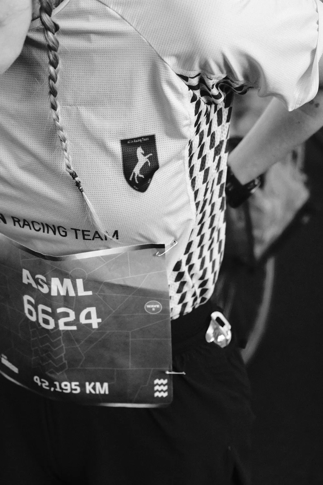

```{=html}
<main>

<!-- ===== HERO ===== -->
<section class="hero">
  <div class="hero-grid">
    <div class="hero-copy">
      <div class="hero-bib" role="presentation">
        <div class="hero-bib-top"><span><span class="dot">●</span> Ghent, BE</span><span>NO. 01</span></div>
        <div class="hero-bib-name">Emma Boone</div>
      </div>
      <h1 class="hero-title">
        <span class="line"><span>Sport <em class="amp">&amp;</em></span></span>
        <span class="line"><span>Performance</span></span>
        <span class="line line-serif"><span>psychologist</span></span>
      </h1>
      <p class="hero-lede">
        Psychological support in every form: from guidance to get a better grip on your life, to skills that take you to the top level.
      </p>
      <div class="hero-actions">
        <a class="btn" href="contact.html">Book an appointment</a>
        <a class="btn btn-ghost" href="services.html">View services</a>
      </div>
      <p class="hero-meta">Practice in Ghent/Drongen <span class="sep">·</span> also online <span class="sep">·</span> NL / EN</p>
    </div>

    <div class="hero-photo">
      <figure class="photo-frame" style="margin:0">
        
        <figcaption class="photo-caption">
          <span>It's not a sprint, it's a marathon.</span>
        </figcaption>
      </figure>
    </div>
  </div>
  <div class="hero-scroll" aria-hidden="true">scroll</div>
</section>

<!-- ===== TICKER ===== -->
<div class="ticker" aria-hidden="true">
  <div class="ticker-track">
    <div class="ticker-group">
      <span>Focus</span><span>Handling pressure</span><span>Self-confidence</span><span>Resilience</span><span>Motivation</span><span>Recovery</span><span>Flow</span><span>Team dynamics</span><span>Identity</span>
    </div>
    <div class="ticker-group">
      <span>Focus</span><span>Handling pressure</span><span>Self-confidence</span><span>Resilience</span><span>Motivation</span><span>Recovery</span><span>Flow</span><span>Team dynamics</span><span>Identity</span>
    </div>
  </div>
</div>

<!-- ===== WHO IT'S FOR ===== -->
<section class="section">
  <div class="section-head rv">
    <p class="kicker">Who it's for</p>
    <h2 class="d-title">Every arena counts</h2>
  </div>
  <div class="section-inner">
    <div class="lane rv">
      <div class="lane-num" aria-hidden="true">01</div>
      <div>
        <h3>Athletes</h3>
        <p>Athletes, coaches and clubs, from competitive to elite level. Competition nerves, fear of failure, injuries, a comeback, or the question of who you are beyond your performance.</p>
      </div>
    </div>
    <div class="lane rv rv-1">
      <div class="lane-num" aria-hidden="true">02</div>
      <div>
        <h3>Performers</h3>
        <p>Musicians, dancers, actors and chefs. Stage fright, auditions, opening-night nerves and performing when it has to happen.</p>
      </div>
    </div>
    <div class="lane rv rv-2">
      <div class="lane-num" aria-hidden="true">03</div>
      <div>
        <h3>Professionals</h3>
        <p>Entrepreneurs, managers and anyone with a demanding job. Deadlines, responsibility, decisions under pressure and the risk of burnout.</p>
      </div>
    </div>
    <div class="lane rv rv-3">
      <div class="lane-num" aria-hidden="true">04</div>
      <div>
        <h3>Psychological support</h3>
        <p>You can also come to me for things unrelated to performance. For grief, identity, trauma, perfectionism, or when you simply feel stuck.</p>
      </div>
    </div>
    <div class="cards-cta rv">
      <a class="btn btn-ghost" href="services.html">View services</a>
    </div>
  </div>
</section>

<!-- ===== QUOTE BAND ===== -->
<section class="band">
  
  <blockquote class="rv">
    Pressure doesn't go away. But you can learn to deal with it differently.
  </blockquote>
</section>

<!-- ===== ABOUT TEASER ===== -->
<section class="section" style="background: var(--paper-deep); border-block: 1px solid var(--line);">
  <div class="section-inner meet">
    <figure class="photo-frame rv" style="margin:0">
      
      <figcaption class="photo-caption">
        <span>Emma Boone, Ghent</span>
        <span class="tag">UGENT</span>
      </figcaption>
    </figure>
    <div class="rv rv-1">
      <p class="kicker">About me</p>
      <h2 class="d-title">Psychologist and athlete</h2>
      <p style="margin-top:1.2rem; color: var(--ink-soft); max-width: 36em;">
        Clinical psychologist, trained in applied sport psychology, and student psychologist
        at Ghent University. I regularly line up at a start myself, so I know competition
        nerves from more than just the textbooks.
      </p>
      <ul class="meet-facts">
        <li>ACT &amp; EMDR</li>
        <li>Student psychologist UGent</li>
        <li>Racing myself</li>
      </ul>
      <a class="arrow-link" href="about.html">Read my background</a>
    </div>
  </div>
</section>

<!-- ===== CTA ===== -->
<section class="start-band">
  <p class="kicker rv">On your marks</p>
  <h2 class="start-title rv rv-1">Ready for the <em>start?</em></h2>
  <a class="btn rv rv-2" href="contact.html">Book an appointment</a>
</section>

</main>
```
